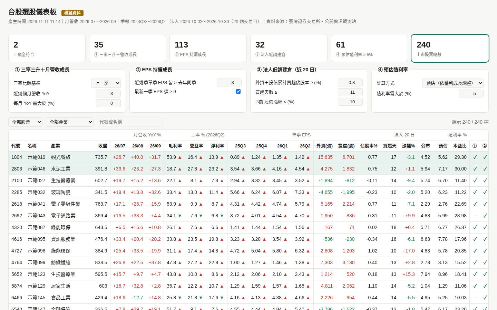

# 台股選股儀表板 Taiwan Stock Screener

用四個條件篩選台灣**上市**股票，產生一個可以即時調門檻、邊調邊看結果的**互動式 HTML 儀表板**，並附 CSV 明細。資料全部來自臺灣證券交易所與公開資訊觀測站的公開資料，不需要任何 API 金鑰。



> 上圖為 `--demo` 模擬資料的畫面（240 檔示範資料），真實資料版的版面與功能完全相同。
> 本工具僅為資訊篩選用途，**不構成投資建議**。投資決策請自行評估風險。

## 四個選股條件

| # | 條件 | 預設定義（門檻皆可在儀表板調整） |
|---|------|----------|
| ① | 三率三升＋月營收成長 | 最新一季「單季」毛利率、營益率、淨利率都高於比較基準（上一季，可切換去年同季），且最近 3 個月月營收 YoY 都 > 0% |
| ② | EPS 持續成長 | 最近 3 季單季 EPS 都高於去年同季，且最新一季 EPS > 0 |
| ③ | 三大法人低調建倉 | 近 20 個交易日，外資（不含外資自營商）＋投信累計買超 ≥ 股本 0.3%、買超天數 ≥ 11 天、同期股價漲幅 < 10%（有買盤、但股價還沒大漲） |
| ④ | 預估殖利率 > 5% | 證交所公布殖利率 × 近四季 EPS ÷ 去年全年 EPS（假設配息率不變）；缺季報或 EPS 為負時，改用證交所公布的殖利率 |

只篩 4 碼普通股。金融保險業沒有毛利欄位，條件 ① 不適用（儀表板會標示）。

## 功能特色

- **KPI 總覽卡**：四項全符合與各條件的符合檔數，點任一張卡直接切換篩選模式
- **門檻即時調整**：四個條件面板的所有數字、比較基準（季比／年同季比）、殖利率計算方式都能改，表格與 KPI 立刻重算，不用重跑程式
- **多種檢視模式**：四項全符合／至少三項／至少兩項／只看單一條件／全部股票，再疊加產業下拉與代號・名稱搜尋
- **27 欄明細表**：月營收 YoY、三率（附與基準比較的 ▲▼）、近四季單季 EPS（附去年同季 ▲▼）、法人買超張數與佔股本比、漲幅、殖利率與本益比、四條件勾選與符合數；任一欄可點擊排序，四項全符合的列會 highlight
- **CSV 匯出**：程式產出 `screen_result.csv`；本地範本的儀表板也可把目前篩選清單另存 CSV
- **深淺色模式**：跟隨系統設定自動切換

## 快速開始

需求：Python 3.10 以上。

```bash
pip install -r requirements.txt

# 1) 先看模擬資料版（不連網，驗證畫面與功能）
python tw_screener.py --demo --out demo.html --csv demo.csv

# 2) 跑真實資料（建議在台灣本地網路執行，原因見「已知限制」）
python tw_screener.py
```

真實資料模式的輸出：

- `dashboard.html` — 互動儀表板（用瀏覽器開啟）
- `screen_result.csv` — 全部上市股票的篩選明細

可選參數：

| 參數 | 說明 | 預設 |
|------|------|------|
| `--days` | 法人統計的交易日數 | 20 |
| `--months` | 月營收回溯月數（至少 3） | 3 |
| `--date` | 基準日 YYYY-MM-DD | 今天 |
| `--out` / `--csv` | 輸出檔名 | dashboard.html / screen_result.csv |
| `--json` | 另存原始資料 JSON | 無 |
| `--demo` | 使用模擬資料（240 檔） | 關 |

所有下載結果快取在 `./cache/`，重跑只補抓缺的部分。程式對來源網站每次請求間隔 3 秒，請勿改小。

## 操作說明（儀表板）

1. **看總覽**：頁首顯示資料的產生時間、月營收月份區間、季報季度區間、法人統計區間與實際交易日數。先確認法人天數是否為 20 天（若來源限流提早停止，天數會少於 20，條件 ③ 的買超天數門檻會依實際天數比例換算）。
2. **點 KPI 卡篩選**：點「四項全符合」看精選名單；點 ①～④ 任一卡看符合該單一條件的股票；點「上市股票總數」回到全部。
3. **調門檻**：在四個條件面板修改數字或下拉（例如把殖利率下限從 5% 改成 6%、三率改與去年同季比），畫面即時更新，不需要重新抓資料。
4. **切換模式與搜尋**：工具列可選「至少三項／至少兩項」放寬名單，搭配產業下拉與關鍵字（代號或名稱）快速定位個股。
5. **排序找線索**：點欄位標題排序，例如按「佔股本%」由高到低看法人建倉力道、按「預估殖利率」找高殖利率名單；再點一次切換升／降序。
6. **看 ▲▼ 判讀三率與 EPS**：三率欄的 ▲▼ 是與你選的比較基準相比，EPS 欄是與去年同季相比，一眼看出改善或衰退。
7. **匯出**：需要進一步分析時，用 `screen_result.csv` 在試算表或程式裡再加工。

## 資料來源與計算方式

| 資料 | 來源 |
|------|------|
| 季報（綜合損益表彙總） | 公開資訊觀測站 MOPS `ajax_t163sb04` |
| 月營收 | MOPS `t21sc03` |
| 三大法人買賣超、收盤價 | TWSE `T86`、`MI_INDEX` |
| 公司基本資料（股本、產業）、殖利率／本益比 | TWSE OpenAPI `t187ap03_L`、`BWIBBU_ALL` |

- 季報公布的是**年初累計數**，單季 = 本季累計 − 上季累計（Q1 直接用累計數）。
- 季報只採用**已過公告截止日**的最新一季：Q1 5/15、Q2 8/14、Q3 11/14、Q4 次年 3/31。
- 月營收於次月 10 日前公告；最新月份若少於 100 家公司公布，程式會自動往前退一個月。
- 法人「佔股本%」=（外資＋投信累計買賣超股數）÷ 已發行普通股數；「買超天」= 外資＋投信合計買超的天數；「漲幅」= 統計期間首尾兩日收盤價變化。
- 「預估殖利率」假設配息率不變：以最新殖利率按近四季 EPS 與去年全年 EPS 的比例調整。

## 建議更新時機與定時更新

各資料的更新節奏不同，建議照下表排程，不必天天全跑（快取會只補新的部分）：

| 資料 | 來源公布節奏 | 建議重跑時機 |
|------|--------------|--------------|
| 三大法人＋股價（條件 ③） | 每個交易日盤後 | **每個交易日收盤後**（如平日 15:00 後）跑一次，20 日窗口才會正確滾動 |
| 殖利率（條件 ④） | 每日更新 | 隨法人資料一起每日更新即可 |
| 月營收（條件 ① 後段） | 每月 10 日前全數公布 | **每月 11 日**跑一次 |
| 季報三率＋EPS（條件 ①②） | 每季截止日後 | **每季 5/16、8/15、11/15、次年 4/1**（截止日隔天）跑一次 |

本機排程範例（Linux／macOS crontab，交易日 15:30 更新）：

```cron
30 15 * * 1-5 cd /path/to/tw-stock-screener && python3 tw_screener.py
```

Windows 用「工作排程器」建立每日（週一至週五）觸發的工作，動作指向 `python tw_screener.py` 並設定起始資料夾為本 repo 目錄即可。

> ⚠️ 不建議用 GitHub Actions 等雲端 CI 排程跑真實資料：雲端 IP 會被 MOPS 嚴重限速（實測約 15 KB/s，單季季報下載約 2 分鐘，且程式逾時需拉長），也可能被 TWSE 限流。排程請放在**自己的電腦或台灣網路環境**執行；雲端環境請用 `--demo` 驗證功能即可。

## 已知限制

- **MOPS 對雲端 IP 限速／阻擋**：季報與月營收在雲端主機上下載極慢（實測約 15 KB/s）或逾時，條件 ①② 的歷史資料建議在台灣本地網路抓取。本 repo 程式的下載逾時已設為 300 秒以因應限速（2026-11-11 雲端實測：單季季報 1.6 MB 約 107 秒可完整下載並正確解析）。
- **TWSE 流量限制**：連續請求過多可能回 307／403；程式遇到會立即停止法人統計，改用已取得的交易日計算（頁首會顯示實際天數），不要密集重試。
- **OpenAPI 只有最新一期**：歷史季報與月營收無法用 OpenAPI 補齊，只能當輔助來源。
- 請勿使用繞過網站防火牆或限流的方法（換 IP、偽造來源等）。

## 自訂與擴充

- 預設門檻集中在 `tw_screener.py` 的 `DEFAULTS`，儀表板初始值也從這裡讀，改一處即可。
- 新增條件時，Python 的 `screen()`（CSV 用）與範本 JS 的 `evalStock()`、COLS、KPI、mode 選項要同步修改，兩邊邏輯需一致。

## 作為 AI Skill 使用

本 repo 同時是一個可攜的 agent skill：把 `SKILL.md` 連同 `tw_screener.py`、`dashboard_template.html`、`requirements.txt` 放進你的 agent skills 資料夾，agent 就能照流程幫你建檔、驗證、抓資料、核對數字與交付儀表板。

## License

MIT License，著作權人：金霸。詳見 [LICENSE](LICENSE)。
